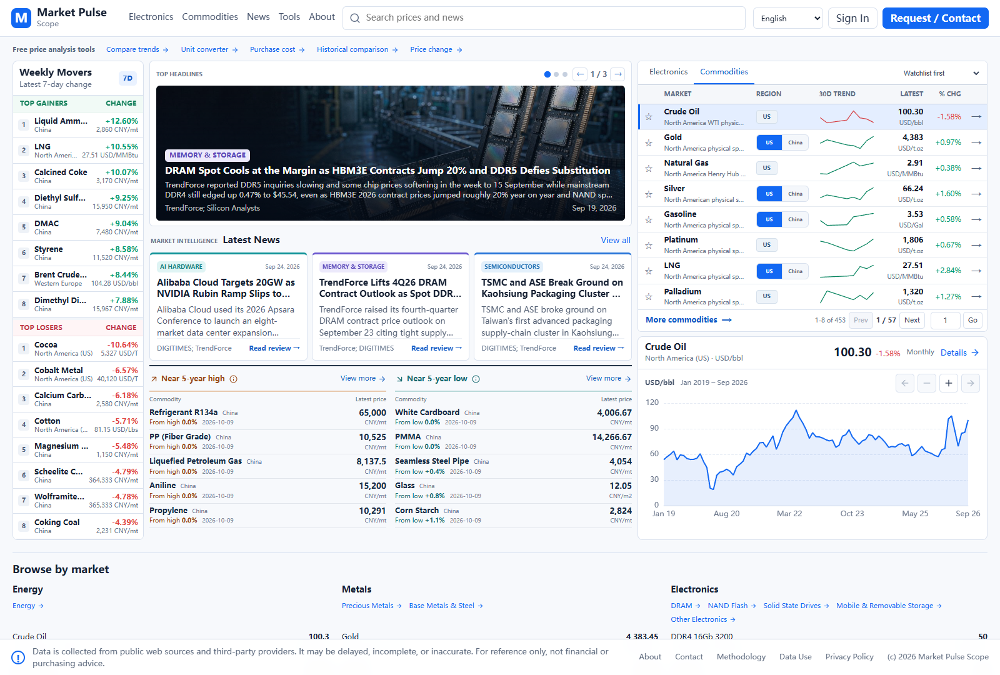
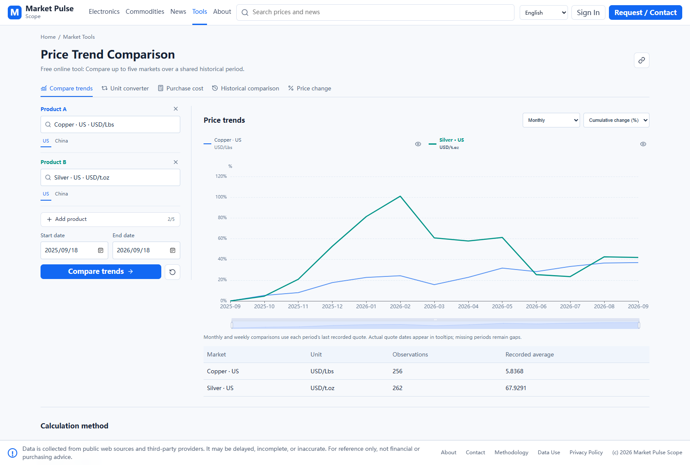

# From Price Lookup to Price Analysis: Five Free Tools for Market Pulse Scope

Market Pulse Scope is growing from a price-history website into a practical browser-based analysis toolkit for commodities, electronic components, and shipbuilding markets.

## What is in this update?

| Tool | A practical use |
| --- | --- |
| Price Trend Comparison | Compare up to five markets in one chart, as actual prices or cumulative percentage changes. |
| Commodity Price Converter | Convert price units and currencies with explicit FX and physical assumptions. |
| Commodity Price Calculator | Work out purchasing costs from quantity, price, and optional freight. |
| Historical Price Comparison | Compare two dates or overlay two historical periods. |
| Price Change Calculator | Calculate absolute and percentage changes from entered or recorded prices. |

Online viewing of available price histories and use of the five tools are currently free. Existing CSV account and daily limits remain in place.

The homepage also brings together weekly movers, price sparklines, market news, and separate five-year high/low watch panels. The watch uses available recorded observations for each regional series; it is not a prediction or a trading signal.

[See all five tools with screenshots and examples](docs/market-pulse-scope.md).

I am developing the website independently and would appreciate practical feedback: which tool would help in your research or purchasing workflow, and what should be improved next?

[Explore Market Pulse Scope](https://marketpulsescope.com/?utm_source=github&utm_medium=referral&utm_campaign=awesome_market_data_resources) · [Try the free tools](https://marketpulsescope.com/tools/?utm_source=github&utm_medium=referral&utm_campaign=awesome_market_data_resources)

Screenshots are local development previews from October 2026; the deployed version and available data may differ. Calculations are for reference only. Data may be delayed, incomplete, or inaccurate. This repository does not distribute the website's underlying price database, and free viewing does not grant redistribution rights.

## Preview wording if the deployment is not ready

I am preparing a Market Pulse Scope update with five free price-analysis tools: trend comparison, unit and currency conversion, purchase-cost calculation, historical comparison, and price-change calculation. The screenshots show the local preview. I would welcome feedback before the update is deployed.
