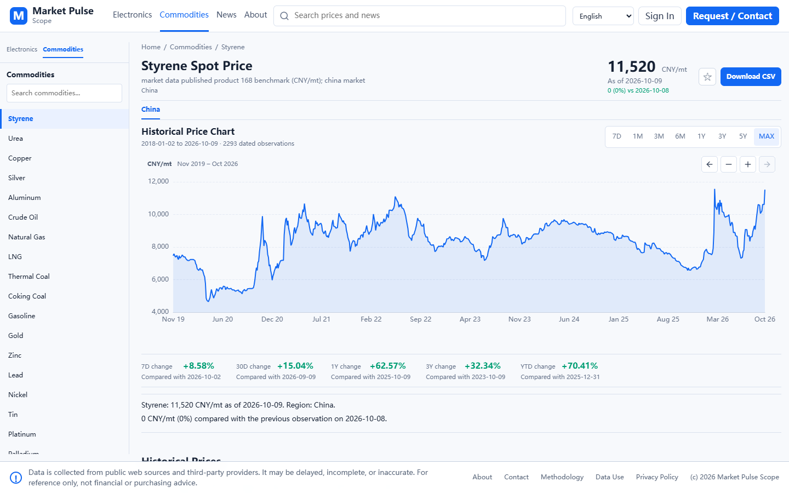
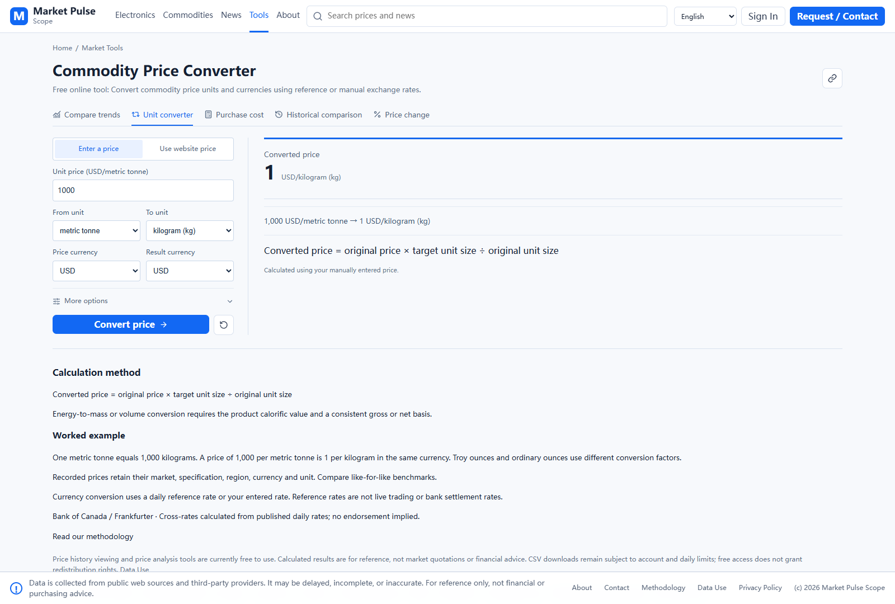
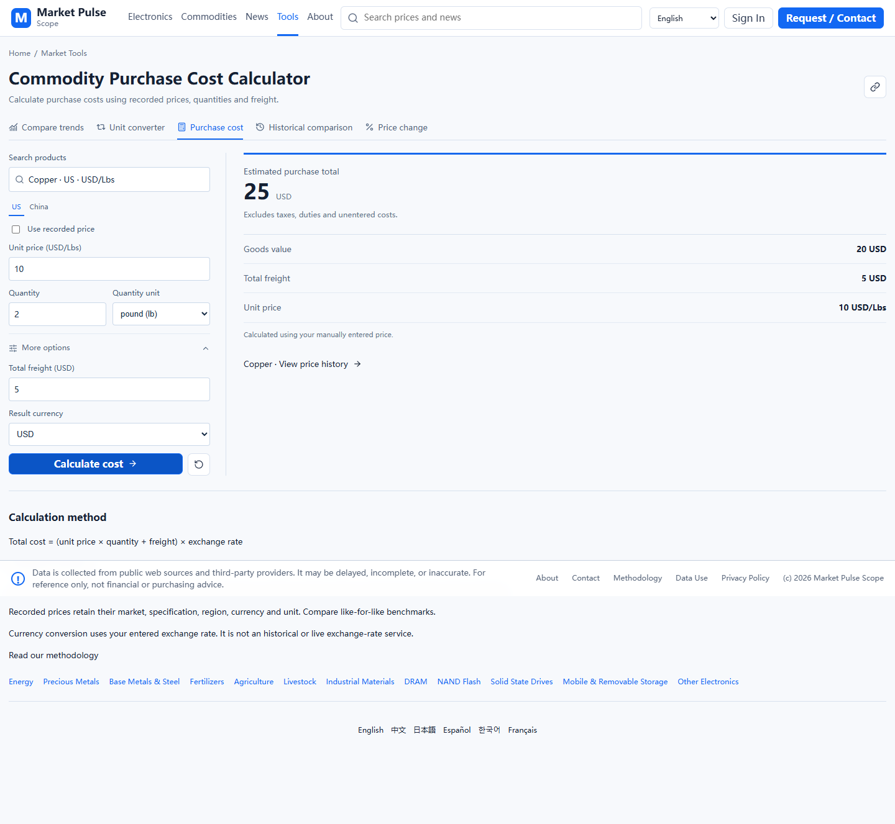
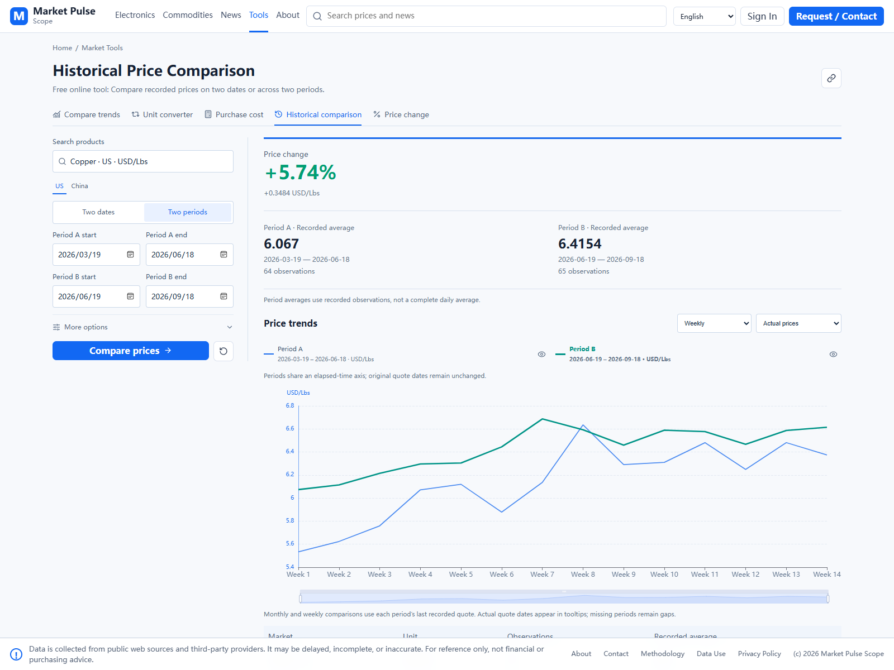
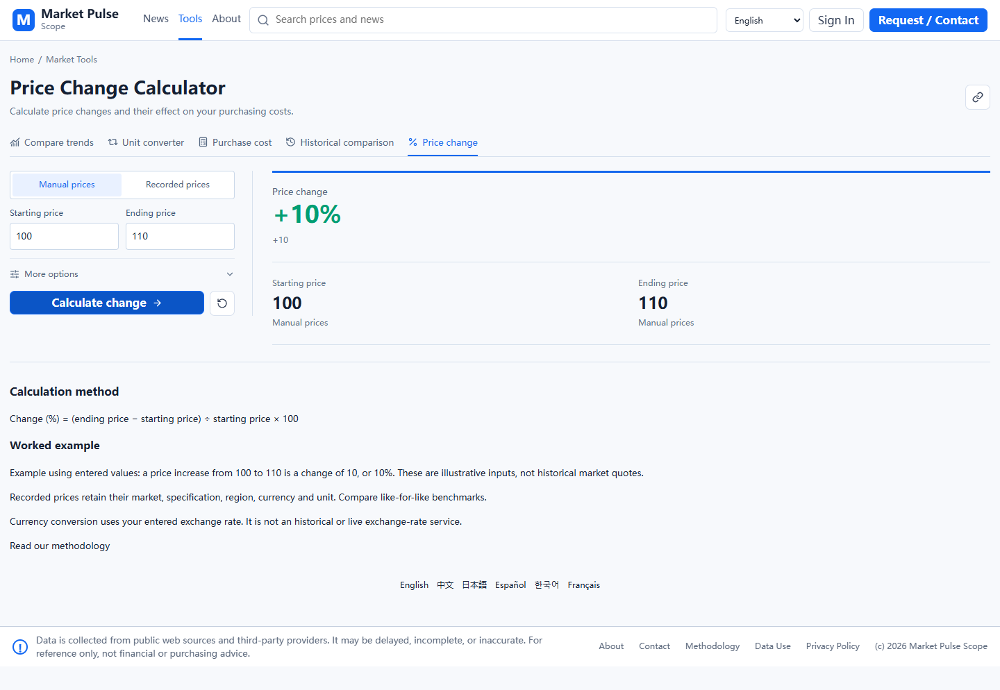

# Market Pulse Scope: Free Price History and Analysis Tools

**Look up a price. Put it in context. Work through the calculation.**

Market Pulse Scope is an independently developed website for exploring commodity, electronic-component, and shipbuilding prices. Available historical prices can be viewed online for free, and its five price-analysis tools are currently free to use.

[Open the website](https://marketpulsescope.com/?utm_source=github&utm_medium=referral&utm_campaign=awesome_market_data_resources) · [Open the tools](https://marketpulsescope.com/tools/?utm_source=github&utm_medium=referral&utm_campaign=awesome_market_data_resources) · [Return to the resource directory](../README.md)

## Contents

- [Market overview](#market-overview)
- [Historical price charts](#historical-price-charts)
- [Price Trend Comparison](#1-price-trend-comparison)
- [Commodity Price Converter](#2-commodity-price-converter)
- [Commodity Price Calculator](#3-commodity-price-calculator)
- [Historical Price Comparison](#4-historical-price-comparison)
- [Price Change Calculator](#5-price-change-calculator)
- [Five-year price watch](#five-year-price-watch)
- [Search, watchlists, news, and languages](#search-watchlists-news-and-languages)
- [Access and data notes](#access-and-data-notes)

Screenshots show the local application during development in October 2026, not a live feed. The deployed website may differ until the corresponding update is published. Existing price records are shown as stored; inclusion in a screenshot does not independently verify their accuracy. Manual calculation examples are labeled below.

## Market overview

Start with a compact view of the markets rather than a long news feed. The homepage brings together weekly gainers and losers, a tabbed price list with trend sparklines, market headlines, a selected-market history chart, and a five-year price watch.

**Useful when:** you want to scan several markets and choose what to investigate next.

Product specifications, regions, units, currencies, and quote dates matter. Two prices with the same commodity name are not automatically comparable.

[Explore the homepage](https://marketpulsescope.com/?utm_source=github&utm_medium=referral&utm_campaign=awesome_market_data_resources)

## Historical price charts

Open a product to inspect its available recorded history. Zoom or pan through the chart, review dated observations and change summaries, and switch regions when that product has displayable quotes for another region. A searchable product browser helps you move between markets.

**Useful when:** you need more context than a single latest-price figure.

*Local preview of a commodity price-detail page. History coverage varies by series.*

[Browse commodity prices](https://marketpulsescope.com/prices/commodities/?utm_source=github&utm_medium=referral&utm_campaign=awesome_market_data_resources) · [Browse electronics prices](https://marketpulsescope.com/prices/electronics/?utm_source=github&utm_medium=referral&utm_campaign=awesome_market_data_resources) · [Browse shipbuilding prices](https://marketpulsescope.com/prices/shipping/?utm_source=github&utm_medium=referral&utm_campaign=awesome_market_data_resources)

## 1. Price Trend Comparison

**Question it helps answer:** how did these markets move over the same period?

Choose two to five products independently, select their available regions and a date range, then display their trends in a single chart.

- **Cumulative change:** compare recorded percentage movements from a common starting observation.
- **Actual prices:** retain the original quote units and currencies, with separate colored scales when needed.
- Focus or hide a line without replacing the selected products.

**Example workflow:** select copper and silver, choose a common date range, and compare cumulative changes. Switch to actual prices to inspect the original quotation scales.

Independent price-axis heights do not imply equal prices. This is a comparison tool, not a statistical correlation score, forecast, or trading recommendation. Missing recorded periods remain missing rather than becoming invented quotes.

[Use Price Trend Comparison](https://marketpulsescope.com/tools/price-trend-comparison/?utm_source=github&utm_medium=referral&utm_campaign=awesome_market_data_resources)

## 2. Commodity Price Converter

**Question it helps answer:** what does this quote mean in the unit and currency I use?

Enter a price manually or use an available website quote, then choose source and target units and currencies.

- Convert compatible mass, volume, or energy price units.
- Distinguish metric tonnes, short tons, long tons, and ordinary versus troy ounces.
- Use a dated reference FX rate when available, or enter your own rate.
- For natural gas/LNG conversions across energy, mass, or gas volume, use explicit heat-content and reference-condition assumptions.

**Illustrative manual example:** USD 1,000 per metric tonne equals USD 1 per kilogram, before any currency conversion. This input is not a market quotation.

Reference FX is not a live trading or bank-settlement rate. A physical conversion does not create a new regional market quote; gas properties and conditions must be appropriate to the material being compared.

[Use Commodity Price Converter](https://marketpulsescope.com/tools/commodity-price-converter/?utm_source=github&utm_medium=referral&utm_campaign=awesome_market_data_resources)

## 3. Commodity Price Calculator

**Question it helps answer:** what purchase total follows from my quantity, price, and entered costs?

Choose a product, use a recorded price or manually enter a unit price, set the quantity and its unit, and add optional freight or result-currency settings as needed.

**Illustrative manual example:** 2 lb × USD 10/lb + USD 5 freight = USD 25. This is an arithmetic example, not a current copper quote or supplier offer. Taxes, duties, and costs you have not entered are excluded.

[Use Commodity Price Calculator](https://marketpulsescope.com/tools/commodity-price-calculator/?utm_source=github&utm_medium=referral&utm_campaign=awesome_market_data_resources)

## 4. Historical Price Comparison

**Question it helps answer:** how did the price differ between two dates or two periods?

Choose a product and region, then select one of two modes:

- **Two dates:** compare the available recorded quotes for the selected dates under the displayed date rules.
- **Two periods:** compare recorded observations across two windows and overlay their trends by elapsed time, rather than plotting the periods far apart on a calendar.

**Example workflow:** compare two adjacent three-month periods using weekly observations. Inspect the overlay along with each period's original dates and recorded average.

The average is based on available recorded observations, not a claim that every calendar day was quoted. Missing periods are not filled with estimated prices.

[Use Historical Price Comparison](https://marketpulsescope.com/tools/historical-price-comparison/?utm_source=github&utm_medium=referral&utm_campaign=awesome_market_data_resources)

## 5. Price Change Calculator

**Question it helps answer:** how much did the price change in absolute terms and percent?

Enter a starting and ending price, or use available recorded prices. The tool shows the absolute change and percentage change; optional quantity inputs can help examine purchasing impact without assuming an annual spend.

**Illustrative manual example:** a price increase from 100 to 110 is +10, or +10%. These are entered example values, not a historical market series.

[Use Price Change Calculator](https://marketpulsescope.com/tools/price-change-calculator/?utm_source=github&utm_medium=referral&utm_campaign=awesome_market_data_resources)

## Five-year price watch

The homepage separates commodities near recorded five-year highs from those near recorded five-year lows. Each side has its own **View more** action for a larger list.

- **Near high:** the latest observed price is at least 90% of the highest recorded price in the five-year window.
- **Near low:** the latest observed price is no more than 110% of the lowest recorded price in that window.
- Regions, currencies, and quotation units remain separate.
- Links from the watch can show the matching five-year high and low as labeled reference lines on the price-detail chart.

The high/low panels appear in the [homepage screenshot above](#market-overview). Use quote dates and history coverage to judge relevance. These are extrema of available recorded observations, not guaranteed extrema of all market transactions or buy/sell signals.

## Search, watchlists, news, and languages

- **Search:** find products and onsite news, with price results prioritized and news separated.
- **Watchlist:** save selected markets; signed-in users can associate selections with their account.
- **Market news:** explore price-related context alongside price histories, with news attribution retained on the website.
- **Languages:** browse in English, Chinese, Japanese, Spanish, Korean, or French.
- **Request / Contact:** signed-in users can submit feedback or missing-data requests and view replies in Messages.

The homepage screenshot illustrates the search, market/news layout, and watchlist controls. Availability depends on the current public catalog and enabled website features.

## Access and data notes

Available historical prices can be viewed online for free; the five tools are currently free to use. This is not a promise of permanent free pricing, complete histories, unlimited downloads, or open database access.

CSV downloads require an account and remain subject to daily limits. Public viewing does not grant permission for unauthorized bulk scraping, database copying, or commercial redistribution. Consult the website's [data-use terms](https://marketpulsescope.com/data-license) and [privacy policy](https://marketpulsescope.com/privacy).

Data may be delayed, incomplete, or inaccurate. Tools produce calculations from recorded or entered values, not executable supplier quotations. Nothing here is financial, investment, purchasing, or trading advice.

This repository contains a resource directory and product illustrations, not the website source code or a downloadable price database. No open-data or software license is granted by this feature guide. The directory is maintained by the website's creator; inclusion of external sources does not imply endorsement or a partnership.

## Feedback

For suggestions about this directory or guide, [open a GitHub issue](https://github.com/Huyanxiao/awesome-market-data-resources/issues). For website feedback or a missing-data request, use the website's account-based [Request / Contact form](https://marketpulsescope.com/request-data).

Please do not include credentials, private account information, copied proprietary datasets, or confidential business material in a public issue.

[Explore the free tools](https://marketpulsescope.com/tools/?utm_source=github&utm_medium=referral&utm_campaign=awesome_market_data_resources) · [Back to the directory](../README.md)
